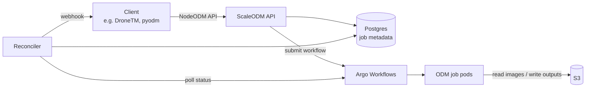

# Architecture

ScaleODM is a single Go service. It takes NodeODM-style API requests and runs
each task as an [Argo Workflow](https://argoproj.github.io/workflows/) on
Kubernetes. Imagery is read from S3 and results are written back to S3.

## Lifecycle of a task

1. **Submit.** The client calls `POST /task/new` with `readS3Path`,
   `writeS3Path` and ODM options. The API checks the input, counts the images
   in S3 and works out how much CPU, memory and disk the job needs.
2. **Run.** The API submits an Argo Workflow and records the job in Postgres.
   The workflow has three steps:
    - **download**: rclone copies the images from S3 into a workspace volume.
    - **process**: the ODM container runs on the images.
    - **upload**: rclone copies the outputs to `writeS3Path`.
3. **Track.** Job status is updated when a client calls
   `GET /task/{uuid}/info`, and by the reconciler, which checks Argo every
   30 seconds. Clients therefore see the right status even after Argo has
   cleaned up a finished workflow.
4. **Notify.** When a job finishes or fails, the reconciler calls the
   client's webhook, if one was given.

There is no queue of its own. Argo and the Kubernetes scheduler (with
Karpenter on AWS) decide when and where pods run.

## Code layout

| Path                 | Purpose                                                                 |
| -------------------- | ----------------------------------------------------------------------- |
| `main.go`            | Startup: config, database, Argo client, reconciler, HTTP server.        |
| `app/api/`           | NodeODM-compatible HTTP API (`/task/*`, `/info`, health checks).        |
| `app/workflows/`     | Builds Argo Workflow specs and sizes resources by image count.          |
| `app/reconciler/`    | Background loop that syncs Argo status to the database and calls webhooks. |
| `app/meta/`          | Job metadata store (reads and writes to Postgres).                      |
| `app/db/`            | Database connection and `schema.sql`.                                   |
| `app/s3/`            | S3 helpers: listing images, output files, scripts used in pods.         |
| `app/config/`        | Environment variable config and defaults.                               |
| `app/ui/`            | Small web UI at `/ui` for browsing jobs (read-only by default).         |
| `app/observability/` | OpenTelemetry traces and metrics.                                       |
| `chart/`             | Helm chart for ScaleODM, with optional Argo and Postgres.               |

## Further reading

- [About](about.md): why ScaleODM exists, compared with NodeODM and ClusterODM.
- [Memory sizing](system-requirements.md) and [swap](swap.md): how job
  resources are calculated.
- [Decision records](decisions/README.md): Argo, S3 credentials and swap.
